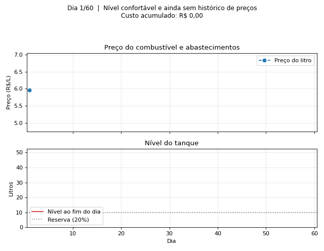
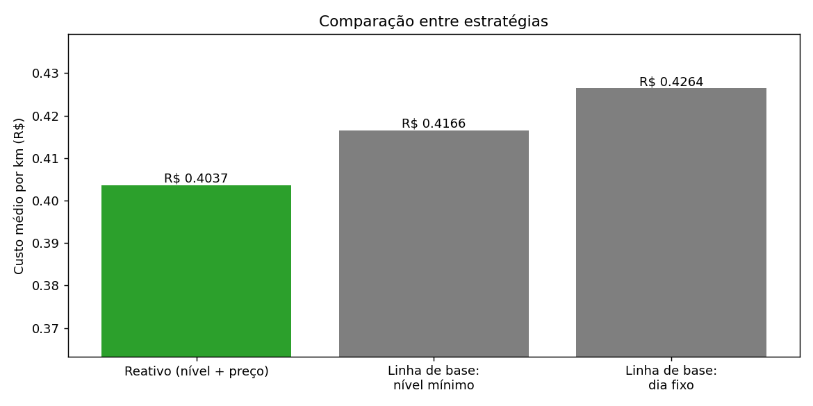

# ⛽ Agente Inteligente para Controle de Combustível

Simulação de um **agente reativo** que decide *quando* e *quanto* abastecer um veículo,
equilibrando o **nível do tanque** e a **oportunidade de preço**. O projeto compara o agente
com estratégias simples de referência (linhas de base) usando várias simulações reproduzíveis.



*Simulação de 60 dias: cada ponto verde é um abastecimento e o título mostra a decisão do dia.*

## Como funciona

O projeto segue o ciclo clássico de agentes inteligentes:

```
        percepção (dia, preço, nível, capacidade)
Ambiente ─────────────────────────────────────────▶ Agente
   ▲                                                   │
   └───────────── ação (litros a abastecer) ◀──────────┘
```

- **Ambiente** (`ambiente.py`): modela o tanque, o consumo (km/L), a distância diária e o
  preço do combustível, sorteados a cada dia. Se o tanque secar, o dia é registrado.
- **Agentes** (`agentes.py`):
  - `AgenteReativo`: enche o tanque por **urgência** (nível abaixo de 20%) ou por
    **oportunidade** (preço abaixo de 95% da média móvel de 7 dias e espaço no tanque).
  - `AgenteNivelMinimo` *(linha de base)*: enche quando o nível cai abaixo de 20%.
  - `AgenteDiaFixo` *(linha de base)*: enche a cada 7 dias.
- **Simulação** (`simulacao.py`): roda o ciclo, entrega um evento por dia (`passo_a_passo`) e
  calcula métricas (custo total, R$/km, preço médio pago, nº de abastecimentos, dias com
  tanque seco). Cada decisão do agente vem com o **motivo** (`Decisao`).

## Instalação e uso

```bash
git clone https://github.com/AnaPaulaTadim/simulacao-agente-ia.git
cd simulacao-agente-ia
python -m venv .venv && source .venv/bin/activate   # no Windows: .venv\Scripts\activate
pip install -r requirements.txt

# uma simulação de 60 dias (mostra o resultado e o gráfico final)
python main.py simular --dias 60 --semente 42

# comparar as estratégias em 500 simulações e salvar o gráfico
python main.py comparar --dias 60 --simulacoes 500 --saida docs/img
```

Uso como biblioteca:

```python
from combustivel import AgenteReativo, Config, simular

config = Config(capacidade_l=50, semente=42)
resultado, ambiente = simular(AgenteReativo(config), config, dias=60)
print(resultado.custo_total, resultado.preco_medio_pago)
```

Todos os parâmetros (capacidade, faixas de preço, consumo e distância) ficam em `Config`.

## Acompanhando a simulação dia a dia

A cada dia o agente não só decide como **explica o motivo** da decisão. Há três formas de
acompanhar isso enquanto a simulação roda:

```bash
# 1) Modo verboso: uma linha por dia no terminal, com resumo final
python main.py simular --dias 60 --verboso --pausa 0.3

# 2) Gráfico ao vivo: os gráficos crescem a cada dia
python main.py simular --dias 60 --ao-vivo --pausa 0.3

# 3) Gravar a simulação em um GIF (como o do topo deste README)
python main.py simular --dias 60 --gif docs/img/simulacao.gif
```

Saída do modo verboso (trecho):

```
Dia  9/60 | R$ 6,44/L | tanque  28,4 L ( 57%) | sem abastecer                 | Nível confortável (28,4 L) e preço sem vantagem
Dia 10/60 | R$ 5,15/L | tanque  24,6 L ( 49%) | ABASTECE 25,4 L (R$ 130,86)   | Oportunidade: preço 12% abaixo da média de 7 dias
Dia 11/60 | R$ 6,21/L | tanque  44,6 L ( 89%) | sem abastecer                 | Nível confortável (44,6 L) e preço sem vantagem
...
============================================================
Resumo: Reativo (nível + preço) | 60 dias
============================================================
Abastecimentos .......... 7 (7 por oportunidade)
Litros comprados ........ 183,3 L
Custo total ............. R$ 976,04
Preço médio pago ........ R$ 5,32/L
Custo por km ............ R$ 0,3736
Dias com tanque seco .... 0
```

No terminal as linhas são coloridas: verde (oportunidade), amarelo (urgência), ciano
(abastecimento programado) e cinza (sem abastecer). Use `--sem-cor` para desativar.

Como biblioteca, `passo_a_passo` é um **gerador** que entrega um `EventoDia` por dia, e você
pode usá-lo para montar a sua própria visualização:

```python
from combustivel import Ambiente, AgenteReativo, Config, passo_a_passo, resumir

config = Config(semente=42)
ambiente, agente = Ambiente(config), AgenteReativo(config)

for ev in passo_a_passo(agente, ambiente, dias=60):
    print(ev.dia, ev.percepcao.preco, ev.decisao.motivo, ev.custo_acumulado)

print(resumir(agente.nome, ambiente))
```

## Resultados

Média de 500 simulações de 60 dias (todas as estratégias enfrentam as mesmas sementes):

| Estratégia                  | R$/km  | R$/L pago | Abastecimentos | Tanque seco |
|-----------------------------|-------:|----------:|---------------:|------------:|
| **Reativo (nível + preço)** | 0,4037 |     5,335 |            9,0 |        0,00 |
| Linha de base: nível mínimo | 0,4166 |     5,746 |            5,1 |        0,00 |
| Linha de base: dia fixo     | 0,4264 |     5,745 |            8,0 |        0,00 |



O agente reativo paga cerca de 7% menos por litro e reduz o custo por km em cerca de 3%
em relação ao melhor baseline, sem deixar o tanque secar.

> **Ressalva:** os preços são sorteados de forma independente a cada dia (distribuição
> uniforme), então *existem* oportunidades de preço a serem aproveitadas. Em preços reais,
> que têm tendência e sazonalidade, o ganho pode ser diferente. Os resultados mostram o
> funcionamento do método, não uma previsão para postos reais.

## Testes

```bash
python -m unittest discover -s tests -v    # ou: pytest
```

## Estrutura

```
├── main.py                  # linha de comando
├── src/combustivel/
│   ├── config.py            # parâmetros
│   ├── ambiente.py          # ambiente e percepção
│   ├── agentes.py           # agente reativo e linhas de base
│   ├── simulacao.py         # gerador passo a passo, execução e métricas
│   ├── terminal.py          # modo verboso e resumo final
│   ├── formatacao.py        # números no padrão brasileiro
│   └── visualizacao.py      # gráficos, gráfico ao vivo e GIF
├── tests/                   # testes automatizados
├── notebooks/demo.ipynb     # demonstração interativa
└── docs/img/                # GIF e gráficos usados neste README
```

## Próximos passos

- Ler preços reais de um CSV (por exemplo, séries históricas da ANP).
- Otimizar `nivel_minimo` e `desconto` com busca em grade.
- Trocar a regra fixa por **aprendizado por reforço** (Q-learning).
- Considerar abastecimentos parciais e preços diferentes por posto.

## Licença

MIT. Veja [LICENSE](LICENSE).
